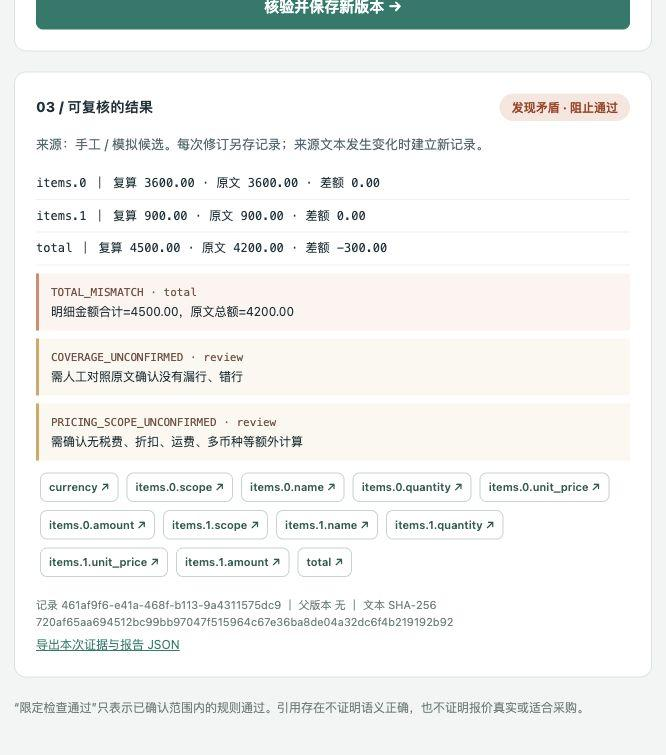
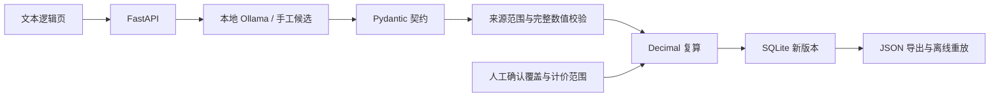

# LineScope Quotes

**每个数值都有自己的明细范围。AI 抽取设备报价，代码检查引用串行与金额矛盾，人工确认漏行和适用范围。**

**Item-scoped evidence checks for AI-extracted equipment quotations.** A number appearing somewhere on the page is insufficient: its evidence must belong to the current item. Decimal arithmetic, explicit review gates and immutable application revisions make failures reproducible.

Local v0.1.0 **release candidate**, not yet published. Code and documentation are assisted by Codex; the learner's independently understood work must be recorded separately.

## 60 秒看点 / Demo

1. 加载“原文少计 300 元”：所有数字都来自原文，复算仍阻止通过。
2. 加载“引用串到另一行”：数字确实在同一页，但不属于当前明细，拒绝该证据。
3. 正常报价仍显示“待人工复核”；确认明细完整、简单计价后另存一个通过限定检查的新版本。
4. 点字段按钮定位文本引用，导出 JSON，用同一版本核验器离线重放。

示例为**自制模拟文本 + 手工候选抽取**，不是实际客户或模型准确率证据。真实模型实测情况见 [验证记录](docs/validation.md)。



[查看关键状态 GIF](docs/demo.gif)（实际界面截图合成，非实时录屏；包括模拟候选与自动化复核测试，不代表用户本人验收）。

## 安装与运行 / Quick start

Python 3.11+。首次安装需要网络下载依赖；安装后无需模型即可运行规则演示。

```bash
git clone <发布后填入你的实际 GitHub 仓库地址>
cd linescope-quotes
python -m venv .venv
# macOS / Linux
source .venv/bin/activate
# Windows PowerShell 改用： .venv\Scripts\Activate.ps1
python -m pip install -e ".[dev]"
python -m uvicorn linescope.app:app --host 127.0.0.1 --port 8765 --no-access-log --log-config logging.json
```

打开 <http://127.0.0.1:8765>。Windows 不能激活时可用 `.venv\Scripts\python.exe -m ...`；macOS/Linux 可用 `.venv/bin/python -m ...`。当前目录需可写；数据库默认在 `data/`。

上方 clone 地址是待发布占位符；当前可直接进入这份本地目录开始 `python -m venv`。没有虚构公开仓库链接。

### 本地 AI 抽取 / Optional local inference

从 [Ollama 官网](https://ollama.com/download) 下载。选择适合本机的开放权重模型，首次需下载模型文件；软件免费不代表没有磁盘、内存和电费开销。

```bash
ollama pull qwen3:1.7b
ollama serve
```

在第二个终端激活项目环境，并设置进程环境变量（`.env.example` 不会被 Python 自动加载）：

```bash
# macOS / Linux
export OLLAMA_MODEL=qwen3:1.7b
export OLLAMA_BASE_URL=http://127.0.0.1:11434
python -m uvicorn linescope.app:app --host 127.0.0.1 --port 8765 --no-access-log --log-config logging.json
```

PowerShell 使用 `$env:OLLAMA_MODEL="qwen3:1.7b"` 和 `$env:OLLAMA_BASE_URL="http://127.0.0.1:11434"`。然后点页面“使用已配置的本地 Ollama 抽取”。模型离线、超时或输出非法时返回错误；不会悄悄用演示数据代替。

## 差异与边界 / Scope and differences

- [LangExtract](https://github.com/google/langextract) 已有来源定位与可视化，不能把引用定位当作本项目发明。
- [invoice2data](https://github.com/invoice-x/invoice2data) 已有模板、明细和 AI 回退。
- [AI Procurement Verification Agent](https://github.com/AnishaPaturi/AI-Procurement-Verification-Agent) 已做订单/发票差异分析。
- [Tender Evaluation Assistant](https://github.com/tender-eval-ai/tender-evaluation-assistant) 已做证据引用、人工修订与确定性价格排序。

本项目选择更小的交付：**当前明细范围内的字段证据校验 → 完整数值边界检查 → Decimal 复算 → 显式人工确认 → 可离线重放的修订记录**。这是场景和工程设计的差异化尝试，不主张首创算法或市场独占。竞品缺口尚未经全面代码审计和用户访谈验证，见 [5 方案调研与评分](docs/selection.md)。

MVP 支持 UTF-8 文本逻辑页、至多 8 页 / 24,000 字符 / 20 条明细、人民币单币种、非负两位金额、正数量，逐行四舍五入至分后相加。AI 处理抽取，规则负责可证明的检查；不需要 LangChain、向量库、Redis 或多 Agent。

**不支持** PDF/OCR、图片、复杂税费/折扣/运费、多币种、分期、单价超过两位小数、负金额。语义角色和行范围由候选提供，仍须人工核对；原文有数字不证明语义正确，覆盖确认不构成自动漏行检测。原文/SQLite 可被本机用户修改，SHA-256 仅标识内容，不证明签名、真实性或防篡改。无用户、收益或提效比例声明。

## 验证 / Reproduce

```bash
python -m pytest -q
python scripts/evaluate.py
python -m linescope.replay path/to/export.json
python -m build
```

结果与环境记录在 [docs/validation.md](docs/validation.md)。规则合成用例的通过率不能当成真实模型抽取准确率。模型本身另行运行 `python scripts/live_smoke.py`，见记录和使用边界。

2026-10-30本机记录：55项自动测试通过；8个合成规则案例符合期望；Ollama真实抽取、错误总额阻止、Docker构建/健康/重启持久化与容器到宿主模型调用已实测。Windows和GitHub远程CI未实测；真实模型只有小样本观察，无准确率或提效保证。

## 架构 / Architecture



## Docker

```bash
docker compose up --build -d
docker compose ps
docker compose logs app
docker compose down
```

Compose 仅映射宿主机 `127.0.0.1:8765`，命名卷保留数据库。容器通过 `host.docker.internal:11434` 调用宿主 Ollama；Mac 上宿主服务若只监听 127.0.0.1，容器可能连不上，规则演示仍可用。不要为解决这个问题直接把 Ollama 暴露到不受控网络；优先在宿主运行本应用。详见 [部署与排障](docs/operations.md)。

## 开发、学习与发布

- [系统设计、API、数据和安全边界](docs/architecture.md)
- [18 天开发与独立验收计划](docs/development-plan.md)
- [面试讲解、岗位版本与 15 个追问](docs/interview.md)
- [贡献说明](CONTRIBUTING.md) · [v0.1.0 发布草稿](docs/release-v0.1.0.md)

## English overview

LineScope Quotes is a local, single-user prototype for simple CNY equipment quotations. Ollama proposes structured fields; deterministic Python checks exact quotations within each item scope, whole numeric tokens, Decimal arithmetic and explicit human review gates. Revisions preserve the original source and candidate through the application API. Exported JSON can be replayed without a model.

The built-in demo uses synthetic, manually authored candidates. It does not measure model accuracy. Input pages are logical text pages, not PDF coordinates. No OCR, tax logic, procurement recommendation, authenticated reviewer identity, automatic completeness proof or tamper-proof ledger is provided. All measured results and unverified deployment paths are listed in the validation report.

Install with `python -m pip install -e ".[dev]"`, run the Uvicorn command above, open localhost:8765, and choose one of three demo scenarios. For real extraction configure a local Ollama model. This is an engineering workflow prototype, not a novel model or algorithm.

## License

MIT for original code, docs and synthetic examples. Third-party model weights retain their own licenses and are not bundled.
