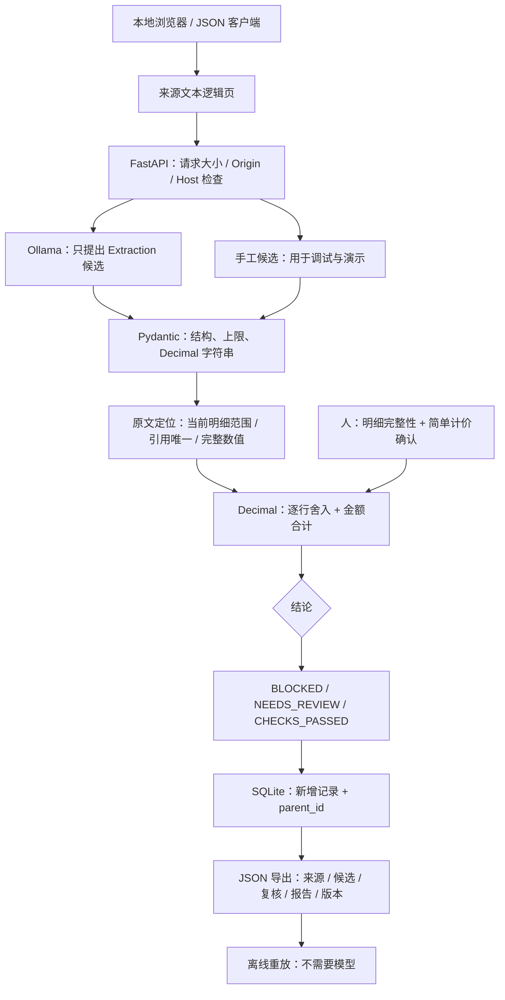

# LineScope Quotes 系统设计

定位：为小型设备报价的 AI 抽取提供**当前明细范围的来源验证、简单金额复算和可重放人工复核记录**。目标用户是采购助理、帮助客户整理设备报价的实施工程师，以及需要这个核验环节的开发者。它不自动推荐供应商，也不代替采购决策。

## 取舍和 MVP

可行方案有：① 只让大模型输出判断；② 引入通用文档平台、多 Agent 和检索；③ 本地模型提候选，少量确定性规则验证。选择③：可解释、可测试、预算低，初学者可以沿一条调用路径理解。若输入始终是固定模板，正则/模板抽取可能已经足够，必须把它当实际基线；没有必要为了“AI”给确定性任务增加推理。

MVP：文本输入、Ollama 结构化抽取、当前明细范围定位、引用与值一致性、完整数值检查、Decimal 行金额/合计复算、显式覆盖/简单计价确认、SQLite 新版本、JSON 导出、离线重放、三个演示场景。模型失败返回错误，不自动降级到模拟抽取。手工候选流程用于隔离核验器故障与模型故障。

排除：PDF/OCR、跨文档 PO 匹配、税额计算、复杂折扣、多币种、真实身份认证、多租户、高并发队列、自动执行命令和云托管。Docker 和真实模型的实测状态看验证记录。

## 架构图



这是顺序流程，一个 Python 进程。SQLite 写入短事务；模型调用在事务外。尚未实现队列、限并发和分布式工作进程，仅适用于本地低负载。

## 技术栈

| 选择 | 理由与边界 |
|---|---|
| Python 3.11+ | 初学者可读、跨平台；当前本机具体版本见验证记录 |
| FastAPI | HTTP 路由与校验入口；独立前后端部署没有必要 |
| Pydantic v2 | 同一模型输出 JSON Schema 并检查候选；合法 JSON 不等于正确抽取 |
| Decimal | 避免二进制浮点误差；明确人民币逐行 ROUND_HALF_UP 至分，不自动推断税/舍入规则 |
| SQLite / sqlite3 | 本地持久记录、短事务、参数化查询；没有 ORM、迁移框架或服务端数据库 |
| HTTPX → Ollama | 直接调用本地 `/api/chat` 并提供 schema；不引入 Agent 框架 |
| 原生 HTML/CSS/JS | 三个场景及证据定位，避免前端构建链 |
| pytest / GitHub Actions | 核验反例、HTTP 边界、持久化和模型异常路径；不需要付费模型 |
| Docker Compose | 可交付的单容器及数据库卷；容器运行状态必须实测后再宣称 |

`pyproject.toml` 使用兼容范围；`requirements.lock.txt` 记录这次本地解析的确切依赖，不能保证未来其他平台所有包兼容。可通过 `python -m pip install -r requirements.lock.txt` 后 `python -m pip install -e . --no-deps` 复现。

## 目录和阅读顺序

```text
linescope-quotes/
├── src/linescope/
│   ├── models.py          # 文本、候选、复核、报告契约
│   ├── verifier.py        # 关键证据约束与 Decimal 计算
│   ├── extractor.py       # 有界本地模型调用
│   ├── store.py           # SQLite 新增与查询
│   ├── app.py             # API、请求边界和结构化日志
│   ├── replay.py          # 导出报告的离线复算
│   ├── demo.json          # 自制模拟来源和手工候选
│   └── static/            # 本地页面
├── tests/                 # 核验、模型适配器、API
├── scripts/               # 合成规则评估和真实模型烟测
├── examples/              # 模拟报价及来源说明
├── docs/                  # 调研、设计、计划、验证、面试、发布
├── .github/               # CI 与 Issues 模板
├── Dockerfile / compose.yaml
├── pyproject.toml / requirements.lock.txt
├── logging.json / .env.example
└── .local/ / data/         # 被忽略：下载、模型、环境与实际记录
```

先读 models→verifier→测试；再读 extractor→app→store→replay。不要先背框架名。

## 核心规则

1. 页号仅是调用方给出的文本逻辑页号，不是 PDF 坐标。页号唯一，总来源 ≤24,000 字符，≤8 页，≤20 条明细。
2. 明细 scope 必须在指定页原文中唯一出现；重叠明细范围阻止通过。字段证据只能在当前 scope 内定位。
3. 数值证据只能含一个完整数值；`1200` 不能截取原文 `1200.00`。匹配原文 token 边界，既检查字符串也检查数值。重复时请扩大引用上下文，不自动取第一处。
4. 数值用有限位数的非负十进制字符串输入；拒绝 JSON float、负数、NaN、无穷和指数计法。数量必须 >0；单价/金额限定至分。
5. 单条金额 = 数量×单价，ROUND_HALF_UP 到分；报价总额 = 抽取明细金额之和。原文与候选共同写错总额，也会被复算发现。一个已知行矛盾即使总额相抵也不能通过。
6. 缺值、引用歧义、未确认明细完整/计价范围，进入 NEEDS_REVIEW；有已证实矛盾则优先 BLOCKED；只有限定规则全部通过且复核已确认，才是 CHECKS_PASSED。
7. 模型不能提交 Review。人工复核由另一个 API 请求提交，必须记录非空标记和理由；标记是自报文本，不是认证身份。
8. 同一来源的候选修改另存新版本。若原文错误，不能仅改候选让系统通过；必须提供修订后的原文，建立新记录并得到不同内容哈希。

**无法证明的事情**：scope 可能被模型选错或扩得过大；名字/数字出现不证明字段语义正确；漏一整行可能无法自动发现；多个币种或复杂计价不一定能自动识别。人工复核可能做错。系统显示的是有限规则结果，不能包装成“报价正确率 100%”。

## API

| 方法与路径 | 输入 / 输出 | 关键行为 |
|---|---|---|
| GET `/health` | 版本、SQLite 状态、模型是否配置 | 不探测模型，不把 configured 当 ready |
| GET `/api/demo` | 模拟来源及手工候选 | 可离线演示，不冒充推理 |
| POST `/api/extract` | `{document}` → 完整新记录 | 调用服务端配置模型；Review 强制未确认 |
| POST `/api/runs` | `{document, extraction, review?}` → 新记录 | 手工/外部候选，明确 metadata.mode=manual |
| GET `/api/runs/{UUID}` | 完整记录 | 404/422 区分不存在与格式错误 |
| POST `/api/runs/{UUID}/revisions` | `{extraction, review}` → 新记录 | 保持来源，parent_id 链接旧记录，不提供覆盖 API |
| GET `/api/runs/{UUID}/export` | JSON 下载 | 包含来源明文，仅面向本机用户 |

GET `/openapi.json` 可查看精确契约。页面配置 CSP 只允许自身脚本，因此默认 `/docs` 使用的第三方 CDN 脚本可能被阻止；直接使用 OpenAPI JSON 或本地页面。API 成功创建返回 201；业务发现矛盾仍返回报告，不与 HTTP 服务异常混为一谈。

例：`total={"value":"4500.00","evidence":{"page":1,"quote":"合计 4500.00"}}`。每条 item 有 item_id、scope、name、quantity、unit_price、amount；未知字段用 value/evidence 为 null，不能自动推算补全。

## 数据存储和重放

只有 `runs(id TEXT PRIMARY KEY, parent_id REFERENCES runs(id), payload TEXT)` 一张表。payload 保存 created_at（UTC）、Document、Extraction、Review、metadata 和 CheckReport。每次新 UUID；不去重，重复点击也会生成单独记录。没有用户/租户表、缓存或自动保留策略。

SHA-256 基于原始页次序、页号和精确文本的 UTF-8 JSON，空白或页序变化会改变哈希。保存 verifier_version、prompt_version 和模型标签；模型标签不是权重 digest，真实实测另外记录本地 digest。离线重放在**相同核验器版本**复算并比较完整 report；它不重做推理，也不证明过去的人工复核真实。

SQLite API 追加不等于数据库不可篡改；尚无签名、哈希链、权限系统。备份应停止本应用后复制 SQLite，恢复到新文件路径验证旧记录仍可重放。

## 日志、异常、安全与隐私

使用 logging.json 启动时生成 request_id/method/路由模板/status/elapsed_ms，不写文档、候选、模型原始响应、API key。验证错误只返回字段路径，不回显输入值。未预料到的错误仍须根据实际日志排查，不能自动声称已全面脱敏。

模型超时→504；不可用、HTTP 错误、超长、非法/截断响应→503 + 稳定错误码；数据库不可用→503。连接超时 3 秒，读写阶段超时 120 秒，不是整个请求的严格 120 秒总 SLA。模型响应 ≤256 KiB；HTTP 请求 ≤256 KiB。JSON 验证失败422，跨 Origin 写入403，错误 Host400，非 JSON 写入415。

Ollama 地址只能由服务端环境变量配置，限本机 HTTP origin，不带凭据/路径，不跟随重定向、不继承代理环境、不允许用户请求传任意 URL。`host.docker.internal` 仅用于容器到宿主场景；无任意工具和命令执行能力。提示词分开 system 与 untrusted source，**这不是提示注入免疫证明**；恶意来源仍可能污染候选，必须检查。

绑定 loopback；Docker 端口只映射 loopback；不打开跨域。静态 UI 用 textContent 展示来源/模型文本，不插入 HTML。运行单用户，不对公网提供无认证 API。数据库保存明文，导出也含明文；仅使用授权、已脱敏材料，不上传到 GitHub。模型权重、下载文件、`.env`、实际数据均忽略。首次下载需网络；真实抽取仅调用所配置本地 Ollama，不需要云 API 或必付费服务。

## 指标与后续版本

| 指标 | 分母 / 方法 | 能说明什么 |
|---|---|---|
| 合成规则结果一致数 | 固定 8 个 case；`scripts/evaluate.py` | 当前版本在已知反例上的回归，不是泛化率 |
| 引用定位成功比例 | 实际候选所有非空证据；按字段计 | 可定位性，不是语义正确率 |
| 已知矛盾误通过数 | 独立标注的矛盾样本 | 该样本集上的检查效果，必须报告分母 |
| 模型字段准确率 / 漏行率 | 后续人工逐字段标注，按来源与版式分层 | 真正评估抽取，当前不得以规则用例代替 |
| 观察耗时 | 单次冷/热运行分别记录硬件/模型/输入 | 局部观测，不直接承诺 P95 或吞吐能力 |
| 重放一致性 | 保存导出后，用固定版本重放 | 核验逻辑可复算，不能证明模型每次同输出 |

v0.1：先验证文本核验闭环和本地真实推理；v0.2：原生文字 PDF 页定位、独立未见测试文本与模板/模型基线；v0.3：字段级编辑和显式明细覆盖清单；再考虑税费插件和外部流程接入。每次扩范围先定义计价语义和反例。只有真实需求验证后才做多文档、多用户或部署平台。
